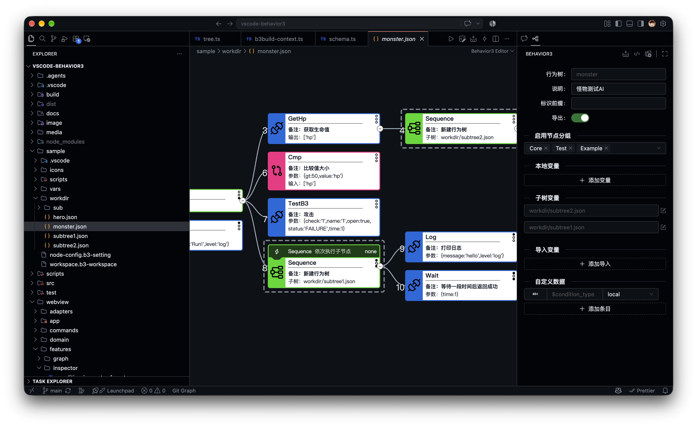

# 行为树框架 for typescript/javascript

## 安装

```bash
npm i behavior3
```

## 用途

在游戏中使用行为树，可以大大降低 AI、技能、BUFF 实现的复杂度，提高配置的灵活度，也更容易找到游戏行为中的问题。主要用途：

- 游戏中人物的 AI
- 游戏中的技能和 BUFF
- 游戏中 NPC 的工作流程
- 游戏中的新手引导
- 游戏中的业务工作流或决策行为

## 快速开始

```typescript
import { Context, Node, Tree, TreeData } from "behavior3";

class GameContext extends Context {
    constructor() {
        super();
        this.registerNode(FindEnemy); // 注册自定义节点
    }

    // 加载树文件，同一个路径只创建一次，所有单位共享
    override loadTree(path: string): Promise<Node> {
        let root = this.trees[path];
        if (!root) {
            const data = JSON.parse(readFile(path)) as TreeData;
            root = this.trees[path] = this._createTree(data);
        }
        return Promise.resolve(root);
    }
}

const context = new GameContext();
const tree = new Tree(context, unit, "ai/hero.json"); // 每个单位一棵 Tree

// 每帧
context.update(dt); // 推进时间和定时器
tree.tick();
```

- 每次 `tree.tick()` 都从根节点开始，沿着正在运行的节点往下执行。
- 树文件由 [Behavior3 Editor](#编辑器) 编辑和导出。
- 单位销毁或者 AI 不再使用时调用 `tree.clear()`，移除这棵树注册的监听和定时器。

## 节点

### 定义节点

节点继承 `Node`，实现 `onTick`，用 `descriptor` 描述自己的参数、输入和输出，编辑器根据它来显示和校验节点：

```typescript
export class FindEnemy extends Node {
    declare input: [number];
    declare args: {
        readonly w: number;
        readonly h: number;
    };

    override onTick(tree: Tree<GameContext, Unit>): Status {
        const [count] = this.input;
        const { w, h } = this.args;
        const { x, y } = tree.owner;
        const list = tree.context.find((unit: Unit) => {
            return unit !== tree.owner && Math.abs(x - unit.x) <= w && Math.abs(y - unit.y) <= h;
        });
        if (list.length >= count) {
            this.output.push(list);
            return "success";
        } else {
            return "failure";
        }
    }

    static override get descriptor(): NodeDef {
        return {
            name: "FindEnemy",
            type: "Action",
            desc: "寻找敌人",
            args: [
                { name: "w", type: "int", desc: "宽度" },
                { name: "h", type: "int", desc: "高度" },
            ],
            input: ["count"],
            output: ["target"],
            status: ["success", "failure"],
        };
    }
}
```

`NodeDef` 的主要字段（完整定义见 [node.ts](src/behavior3/node.ts)）：

| 字段 | 说明 |
|---|---|
| `name` | 节点名，树文件里用它引用节点 |
| `type` | `Action`、`Condition`、`Composite`、`Decorator` |
| `desc`、`doc` | 简介和 markdown 说明，编辑器显示 |
| `args` | 参数：配置在树文件里的常量，比如范围、类型。`type` 带 `?` 的可以不填；`oneof` 表示可以改用某个输入 |
| `input` / `output` | 输入和输出变量名，从黑板读取、写回黑板 |
| `children` | 允许的子节点个数：`-1` 不限，`0`、`1`、`2`、`3` |
| `status` | 节点可能返回的状态，编辑器用来推导和校验 |
| `preemptive` | 组合节点是否支持抢占（见[条件与打断](#条件与打断)） |
| `group` | 节点分组，Context 只注册它支持的分组（`supportGroupTypes`） |

### 黑板、输入和输出

一个节点通常要用到上一个节点的输出或者外部的输入，这些变量存在**黑板**（`tree.blackboard`）上。节点执行时，框架按 `input` 的变量名从黑板读取值放进 `this.input`；节点结束时，把 `this.output` 按 `output` 的变量名写回黑板。

上面的 FindEnemy 执行成功后，黑板上的 `target` 变量就是找到的敌人列表，后面的节点可以把 `target` 作为输入。

### 状态

| 状态 | 含义 |
|---|---|
| `success` | 执行成功 |
| `failure` | 执行失败：正常的否定结果，比如没有敌人 |
| `running` | 运行中，下一帧继续执行 |
| `error` | 数据不可信，比如 id 非法、输入类型不对、缺少必需的输入，节点无法判断成功还是失败 |

- 父节点收到 `error` 也返回 `error`，不会去执行别的分支；`ErrorToFailure` 把它转成 `failure`，让父节点接着执行其它分支。
- `error` 不是异常。节点代码抛出的异常会中断整棵树，派发 `TreeEvent.EXCEPTION`，`tree.tick()` 返回 `"exception"`。

详见[设计文档](docs/design.md)第 3 节。

### 条件与打断

节点上可以挂条件（`conditions`），参考 UE 行为树的装饰器打断（Observer Aborts）：

| abort | 效果 |
|---|---|
| `none` | 只在进入节点时检查 |
| `self` | 节点运行中，条件不成立时打断自己 |
| `lower` | 右侧优先级更低的分支运行中，条件成立时打断它，转而执行这个节点 |
| `both` | `self` 和 `lower` |

逐帧的例子和怎么选 abort 模式见[打断与抢占机制说明](docs/abort-mechanism.md)，格式和规则见[设计文档](docs/design.md)第 4 节。

## 内置节点

### 组合节点

- Selector 选择执行：依次执行子节点，直到有一个返回成功；支持抢占
- Sequence 顺序执行：依次执行子节点，直到有一个返回失败
- Parallel 并行执行：每次执行所有还没结束的子节点；成功的子节点达到 `successCount`（默认全部）时返回成功，不可能达到时返回失败
- Race 竞争执行：并行执行所有子节点，有一个成功就返回成功，全部失败才返回失败
- IfElse 条件执行：根据第一个子节点的结果，执行第二个或第三个子节点
- Switch / Case 分支执行：依次判断每个 Case 的条件，执行第一个满足条件的分支

### 装饰节点

- AlwaysSuccess 子节点成功或失败都返回成功；子节点返回 `error` 时返回 `error`
- AlwaysFailure 子节点成功或失败都返回失败；子节点返回 `error` 时返回 `error`
- AlwaysRunning 返回运行中；子节点返回 `error` 时返回 `error`
- Assert 断言：子节点失败时打印消息并返回 `error`
- Delay 延时执行子节点
- ErrorToFailure 把子节点的 `error` 转成 `failure`
- Filter 返回数组中满足条件的元素
- ForEach 遍历数组
- Invert 反转子节点的成功和失败，`error` 不反转
- Listen 监听事件，事件触发时执行子节点
- Once 只执行一次
- Repeat 重复执行子节点
- RetryUntilFailure 重试子节点，直到返回失败
- RetryUntilSuccess 重试子节点，直到返回成功
- Timeout 限定时间内执行子节点，超时则失败

### 条件节点

- Check 判断表达式
- Includes 判断元素是否在数组中
- IsNull 判断变量是否不存在
- NotNull 判断变量是否存在

### 行为节点

- Calculate 计算表达式，输出结果
- Concat 拼接两个数组
- GetField 获取对象的字段值
- Index 获取数组的元素
- JustSuccess / JustFailure 什么都不做，返回成功 / 失败
- Let 定义变量
- Log 打印日志
- Math 数学运算：abs、ceil、floor、round、sign、sin、cos、tan、atan2、pow、sqrt、log、min、max、sum、average、product、random、randInt、randFloat
- Now 获取当前时间
- Push 向数组中添加元素
- RandomIndex 随机返回数组的一个元素及其索引
- SetField 设置对象的字段值
- Wait 等待一段时间
- WaitForEvent 等待事件触发

## 编辑器

基于 antv G6 图形库开发的通用 vscode 行为树编辑插件：[Behavior3 Editor](https://marketplace.visualstudio.com/items?itemName=codetypess.vscode-behavior3)



编辑器通过 `.b3-setting` 文件读取节点定义，可以用 `context.nodeDefs` 导出（示例见 [test/role.ts](test/role.ts)）。

## 文档

- [设计文档](docs/design.md)：执行模型、状态与错误、条件与打断、参数语义、内置节点、自定义节点
- [打断与抢占机制说明](docs/abort-mechanism.md)：逐帧例子和使用建议

## 开发

```bash
npm test          # 单元测试
npm run check     # 类型检查
npm start         # 运行 example 下的树，并重新生成 example/node-config.b3-setting
npm run bench     # 基准测试
```
